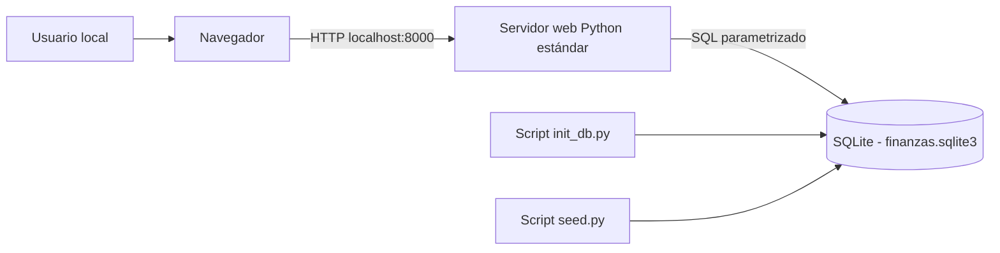

# Control de Finanzas Familiares

**Grupo 5 · Universidad Nacional · Tópicos Avanzados de Bases de Datos · II-2026**

Prototipo **open source** de aplicación web local para registrar ingresos y gastos, consultar un balance mensual, definir presupuestos por categoría y visualizar alertas cuando el gasto llega al 80 % del límite.

> **Estado:** entrega base para Seguimiento 1 (v0.1.0). Proyecto académico con datos sintéticos, **no adecuado para despliegue público ni para información financiera real**: aún no incorpora autenticación, aislamiento entre familias ni protección CSRF.

**Antes de entregar hoy:** leer [ENTREGA_SEGUIMIENTO_1.md](ENTREGA_SEGUIMIENTO_1.md) para saber qué acciones faltan en GitHub.

## 1. Problema y usuarios

Los gastos de un hogar suelen registrarse en lugares separados. Esto dificulta saber cuánto dinero entró, cuánto se gastó y qué categorías consumen el presupuesto.

**Usuarios:** una familia que desea registrar y consultar sus finanzas. En el prototipo existe una sola familia de demostración local.

## 2. Alcance del MVP

| Incluido en la base | Fuera del MVP inicial (roadmap) |
| --- | --- |
| Registro, edición y eliminación de ingresos y gastos | Inicio de sesión y roles de múltiples usuarios |
| Categorías de ingresos y gastos | Transferencias entre cuentas |
| Cuentas de demostración para clasificar movimientos | Múltiples monedas y tipos de cambio |
| Dashboard: ingresos, gastos, balance mensual | Comprobantes adjuntos |
| Límite mensual de presupuesto por categoría | Metas de ahorro y movimientos de ahorro |
| Alerta visual al alcanzar 80 % y 100 % del límite | Notificaciones externas / recomendaciones automatizadas |

El diagrama **v4** de la presentación original contempla entidades adicionales. Por decisión de alcance, la primera implementación usa solo las cinco tablas indispensables; las restantes pueden incorporarse después. El objetivo del curso es defender una solución pequeña y medible.

## 3. Arquitectura



- **Python 3.10+**: servidor HTTP integrado en la biblioteca estándar, vistas HTML y validación de formularios.
- **SQLite**: motor único y fuente persistente para usuarios, categorías, cuentas, movimientos y presupuestos. Se inicia en modo **WAL**, usa claves foráneas e índices.
- **Sin Redis, MongoDB ni Docker**: no tienen un rol necesario para este caso de uso local.
- **Moneda actual:** colones costarricenses, almacenados como **centavos enteros** para evitar imprecisiones decimales.

Ver [arquitectura detallada](docs/arquitectura/diagrama.md) y [modelo de datos vigente del MVP](docs/arquitectura/modelo-v1.md). El esquema ejecutado por la aplicación es **`src/schema.sql`**. El archivo `scripts/schema.sql` es un modelo ampliado propuesto para el futuro: **no ejecutarlo** sobre la base del MVP.

## 4. Requisitos

- Python **3.10 o superior**.
- Windows, macOS o Linux.
- **Cero dependencias externas**: no es necesario instalar Flask, npm, Docker ni drivers SQLite.

## 5. Instalar desde cero (Windows / PowerShell)

Descargar el ZIP del repositorio o clonarlo:

```powershell
git clone https://github.com/sebastins18/Control_Finanzas_Familiares.git
cd Control_Finanzas_Familiares
```

Si se descarga como ZIP, descomprimirlo y abrir la carpeta del proyecto.

```powershell
# Desde la raíz del proyecto
py --version
py scripts/init_db.py
py scripts/seed.py
py scripts/check_connection.py
py -m src.app
```

Abrir **http://127.0.0.1:8000/**. Para verificar la conexión también se puede abrir **http://127.0.0.1:8000/health**. Para detener el servidor, presionar `Ctrl+C`.

En Linux/macOS, usar `python3` en lugar de `py`.

**Ejecutar en otro puerto:** `py -m src.app --port 8080`.

### Variables de entorno

| Variable | Obligatoria | Función |
| --- | --- | --- |
| `DB_PATH` | No | Ruta local al archivo SQLite; si se omite, se usa `data/finanzas.sqlite3`. |

Ejemplo PowerShell:

```powershell
$env:DB_PATH = "$PWD/data/finanzas.sqlite3"
py scripts/init_db.py
```

Existe un archivo `.env.example` de referencia. **La aplicación no lee `.env` automáticamente**; se utilizan variables del sistema o los valores predeterminados. No publicar archivos `.db` con información real.

## 6. Cómo demostrar el MVP

1. Ejecutar el script de inicialización: imprime la ruta y el modo WAL.
2. Ejecutar `seed.py`: genera movimientos y presupuestos **ficticios**.
3. Ejecutar `check_connection.py`: imprime `SQLite: OK` y las tablas.
4. Abrir el dashboard y observar el balance de ingresos y gastos del mes.
5. Agregar un gasto, editarlo y eliminarlo; comprobar que los valores cambian.
6. Definir un presupuesto pequeño para una categoría y mostrar la alerta al superar 80 % o 100 %.
7. Abrir `/health` y mostrar la versión del motor SQLite.

**Fuente de datos:** generador sintético reproducible implementado en `scripts/seed.py`. No se usan datos personales reales.

## 7. Pruebas

```powershell
py -m unittest discover -s tests -v
```

Los casos verifican inicialización, conexión, reglas de validación, CRUD, presupuestos, interfaz HTTP y errores. Se ejecutan usando una base temporal, sin afectar los datos de demostración.

## 8. Organización

```text
src/
  app.py               # Servidor HTTP y vistas
  db.py                # Validación y consultas SQL
  schema.sql           # DDL de SQLite
  static/styles.css    # Interfaz responsive
scripts/
  init_db.py           # Crea esquema y datos maestros
  seed.py              # Generador sintético reproducible
  check_connection.py # Prueba de conexión con el motor
data/                  # Base local (NO se versiona)
docs/
  arquitectura/        # Diagrama, tablas y decisiones
  seguimientos/S1.md   # Bitácora del 16 de octubre
  PLAN_GITHUB.md       # Pasos pendientes en GitHub
tests/                 # Pruebas unittest
```

## 9. Evidencia GitHub

**Repositorio:** https://github.com/sebastins18/Control_Finanzas_Familiares · **Issues:** https://github.com/sebastins18/Control_Finanzas_Familiares/issues · **Tag S1:** https://github.com/sebastins18/Control_Finanzas_Familiares/releases/tag/v0.1.0 (verificar que apunta a la versión final).

El repositorio debe ser público y tener: licencia MIT, Issues con responsables, colaboradores, commits propios de todos los integrantes, y tag `v0.1.0` para el seguimiento 1. **Un ZIP por sí solo no acredita estas acciones.** Consultar [guía para publicar](docs/PLAN_GITHUB.md) y [bitácora S1](docs/seguimientos/S1.md).

## 10. Licencia y próximos pasos

Código bajo licencia **MIT**. Integrantes: Sebastián, Diego, Crystian y Mariano (Grupo 5); sus cuentas GitHub deben agregarse directamente en el repositorio real.

- **Semana 14 / v0.2.0:** consolidar el CRUD, PRs, mejorar validación y carga de datos.
- **Semana 15 / v0.3.0:** experimentos reproducibles de rendimiento **con y sin índice**, EXPLAIN QUERY PLAN, WAL, 3 operaciones × 3 ejecuciones, casos de error y documentación.
- **Semana 16 / v0.9.0:** instalación desde cero realizada por otra persona, capturas, video, changelog, presentación, ficha `portal.yml`.
- **Semana 17 / v1.0.0:** release final y exposición con demo en vivo (si el grupo no adelanta a semana 16).

**Nota:** el enunciado exige al menos 2 de 3 evidencias si se usa un solo motor. Está planificado demostrar: **función avanzada SQLite (WAL)** y **comparación experimental con y sin índices**. Haber creado el esquema no sustituye la medición de la semana 15.
