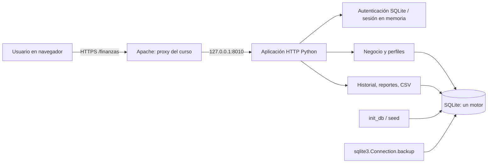

# Arquitectura vigente del MVP — Seguimiento 4

**Corte verificado:** 6 de noviembre de 2026, `main`, `8a88aeb`, con los cambios técnicos de S4 y sus correcciones posteriores. Esta ficha actualiza los esquemas históricos de S1 y V17; **no** sustituye sus registros de evolución.

## Arquitectura de ejecución

En instalación local no se necesita Apache: el navegador conecta directamente al servidor Python en `127.0.0.1:8000`. S4 fue desplegado en CRNube el **6/11/2026 sobre `8a88aeb`**, con respaldo SQLite consistente anterior, según confirmó el responsable. La verificación interna aportada registra **WAL, 17 tablas, integridad `ok` y cero errores FK**. El GET público del login documentado por la automatización no certifica por sí solo el commit o el estado interno del servidor.

## Módulos del código vigente

| Componente | Función |
| --- | --- |
| `src/app.py` | Rutas HTTP, formularios, cookies de sesión, respuestas y dashboard |
| `src/db.py` y `src/schema.sql` | Inicialización, integridad, conexión, modelo inicial |
| `src/extension.py` | Esquema extendido, operaciones y páginas administrativas |
| `src/auth.py` | Usuarios y roles guardados en SQLite, contraseñas con hash y migración |
| `src/profiles.py` / `src/request_ctx.py` | Perfiles financieros, invitaciones y contexto activo |
| `src/finance.py` | Cálculos, movimientos, presupuestos y conversiones |
| `src/reportes.py` / `src/recurrentes.py` | Historial, CSV, reportes y movimientos recurrentes |
| `src/quality.py` / `src/read_cache.py` | Panel de calidad y tratamiento acotado de fallos de lectura |
| `scripts/verify_clean_install_s4.py` | Instalación temporal reproducible: SQLite, seed, HTTP y cookies |
| `scripts/backup_sqlite_s4.py` | Respaldo de SQLite mediante la API `backup`; evita copiar archivos WAL activos |

## Modelo y profundidad de base de datos

Se utiliza **un único motor SQLite**, no PostgreSQL ni MongoDB. Contiene entidades de usuarios, perfiles, cuentas, categorías, movimientos, presupuestos, monedas, tasas, alertas, metas/ahorro, transferencias, comprobantes y movimientos recurrentes. El modelo evolucionó desde las cinco tablas iniciales S1 y el listado de trece tablas V17; la inicialización vigente crea **17 tablas de aplicación**, por lo que se debe consultar el **DDL y las migraciones actuales** al preparar un diagrama físico definitivo, sin afirmar que el modelo todavía tiene exactamente trece tablas.

Medidas demostrables: `PRAGMA foreign_keys`, `integrity_check`, modo WAL para la base de aplicación, SQL parametrizado, transacciones y `EXPLAIN QUERY PLAN`. Las mediciones S3 son **locales, sintéticas y no comparan motores**. Véanse [S3_mediciones.md](../seguimientos/S3_mediciones.md) e [indices_s3.md](../seguimientos/indices_s3.md).

## Flujos ilustrativos

1. **CRUD:** formulario → validación HTTP/negocio → transacción SQLite → consulta → dashboard e historial.
2. **Presupuesto:** movimiento de gasto → acumulado por categoría/período → umbrales 80 % y 100 % → estado mostrado.
3. **Autenticación:** credenciales verificadas en SQLite → cookie HttpOnly y SameSite; `Secure` se activa con `FINANZAS_COOKIE_SECURE=1` al navegar por HTTPS detrás de proxy.
4. **Calidad:** las pruebas inyectan errores, confirman respuestas HTTP controladas y que no se persistan datos inválidos.
5. **Respaldo:** conexión de solo lectura → `sqlite3.Connection.backup` → verificación de integridad/FK → archivo privado.

## Limitaciones y control de alcance

El MVP utiliza `http.server`, sesiones en memoria y aún carece de una política CSRF completa y de protección general contra intentos automatizados. Un CI exitoso **no es certificación de seguridad ni de disponibilidad del sitio público**. Mantener solamente datos ficticios y respaldos privados fuera de `public_html`.

La explicación de arquitectura se consolida con el aporte de Diego Fonseca (`dfonseca15`, `4b0bfed`), [atribución y diferencias](../seguimientos/S4_APORTE_RESPALDO_DIEGO.md). Las 109 regresiones y 27 E2E correctas son evidencia local, no certificación operativa del servidor.

[Guía de instalación S4](../INSTALACION_S4.md) · [Bitácora S4](../seguimientos/S4.md)
