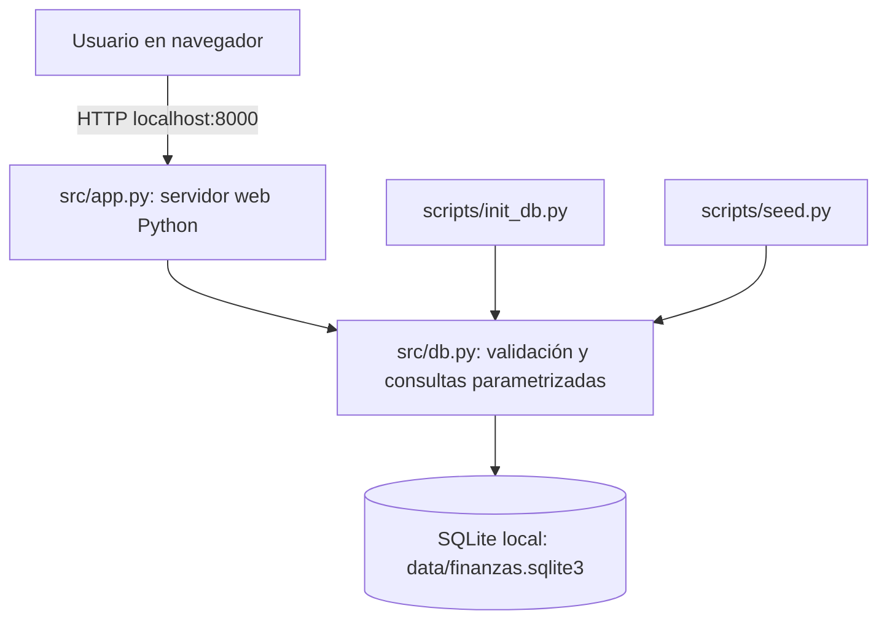

# Arquitectura v1 — Seguimiento 1

**Arquitectura implementada:** aplicación web local con Python 3.10+ (biblioteca estándar), una base de datos SQLite y datos sintéticos.

## Responsabilidad de cada componente

- `src/app.py`: páginas HTML, rutas HTTP y formularios del prototipo.
- `src/db.py`: validación de montos, fechas y relaciones; operaciones sobre SQLite.
- `src/schema.sql`: **único DDL usado para inicializar el MVP**. Contiene las tablas `usuarios`, `categorias`, `cuentas`, `movimientos` y `presupuestos`.
- `scripts/init_db.py`: inicialización del esquema, WAL y catálogos de ejemplo.
- `scripts/seed.py`: datos sintéticos reproducibles.
- `tests/`: casos de CRUD, conexión, errores y HTTP.

## Decisiones

- **Perfil A, un motor:** SQLite es suficiente para un MVP local. Se documentarán el modo WAL, los índices y, en S3, el análisis de `EXPLAIN QUERY PLAN` con comparaciones.
- **Datos coherentes:** claves foráneas habilitadas y parámetros SQL; montos expresados en centavos enteros.
- **Alcance reducido:** un hogar ficticio en CRC; sin autenticación, bancos reales, multimoneda o despliegue público.
- **Propuesta de expansión:** `scripts/schema.sql` y el diagrama de la presentación son **referenciales** y NO se usan en la aplicación actual. No ejecutar ese archivo contra la base MVP.

## Pruebas y fallos

La inicialización y conexión SQLite fueron exitosas en la ejecución local informada el 16/10/2026. Los casos de CRUD y HTTP también pasaron. Se corrigió un import incorrecto de la prueba de conexión; aún falta repetir la batería completa tras esa corrección.

Si SQLite no puede abrir o escribir el archivo, las operaciones deben producir un error y la transacción debe revertirse. Se recomienda probar explícitamente el caso de fallo en S3.

## Evolución esperada

S2: consolidar CRUD, validaciones, PRs y carga. S3: casos de error, índices, métricas (tres operaciones y mediana de tres repeticiones). S4: instalación desde cero por otra persona y demostración final.
