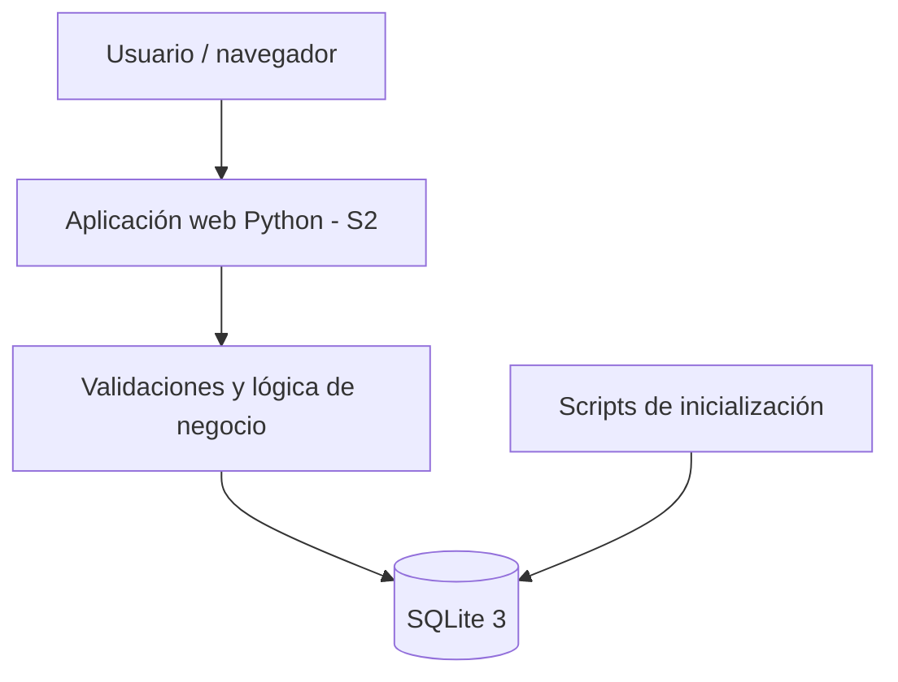

# Arquitectura v1 — Seguimiento 1

## Componentes
1. **Presentación:** futura aplicación web accesible desde navegador (no implementada en S1).
2. **Lógica de negocio:** Python, responsable de validar montos, categorías, límites, fechas y transacciones.
3. **Persistencia:** SQLite 3 para usuarios, monedas, cuentas, categorías, movimientos, presupuestos, metas, alertas y tasas de cambio. Archivo local, sin servidor de base de datos.

## Decisiones
- **Un solo motor:** SQLite evita administrar infraestructura para un proyecto pequeño; cumple el perfil A y exige profundidad técnica en S3.
- **Modelo relacional:** las claves foráneas impiden movimientos sobre cuentas inexistentes y el importe se guarda como centavos enteros, para evitar errores de punto flotante.
- **Una moneda por cuenta:** una transferencia entre monedas requerirá montos de origen/destino y tasa de cambio.
- **Sin datos reales:** solo datos sintéticos/de demostración.
- **Autenticación y sesiones:** representadas en el modelo para crecimiento; por implementar, no se garantiza seguridad de acceso en S1.
- **Medición futura:** comparar consulta con y sin índice, y documentar EXPLAIN QUERY PLAN, tres repeticiones y mediana.

## Fallos y recuperación
Ante un error de archivo bloqueado, permisos o disco, la capa de acceso deberá cerrar/revertir la transacción y devolver un mensaje claro. No existe un motor secundario cuyo fallo deba gestionarse.

## Fuera de S1
Interfaz web, operaciones CRUD, dashboard, alertas automáticas, conversión monetaria efectiva y despliegue. No declarar completas estas funciones sin pruebas.
