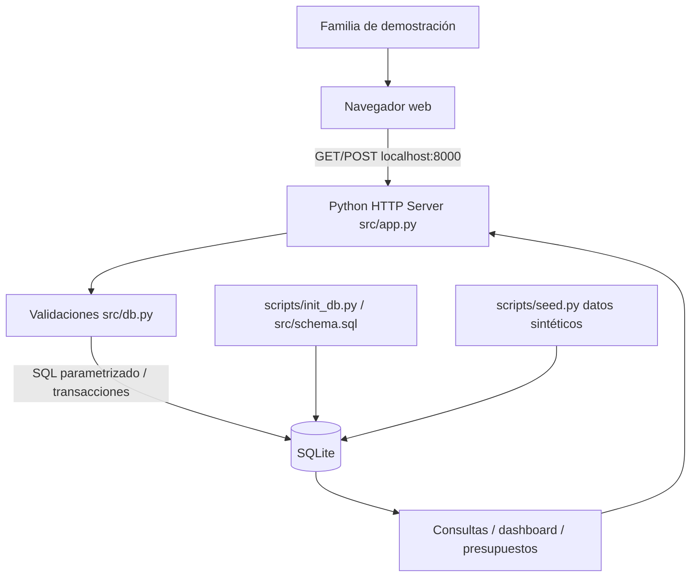

# Arquitectura v1 — Seguimiento 1

## Responsabilidades

| Componente | Responsabilidad |
| --- | --- |
| Navegador | Entrada de datos, tabla de movimientos, resumen mensual, alertas. |
| Servidor web Python | Rutas, HTTP, representación HTML y manejo de errores. |
| `src/db.py` | Validación de tipos, dinero y fechas; SQL parametrizado, integridad. |
| SQLite | Persistencia local; usuarios, categorías, cuentas, movimientos, presupuestos. |
| `init_db.py` | Crear esquema de cero, WAL, índices, tablas y datos maestros. |
| `seed.py` | Generar datos ficticios reproducibles para la demo. |

## Decisión tecnológica

- El requisito es un **único motor** con profundidad en su uso; SQLite es suficiente para consultas y transacciones locales.
- Los índices sobre fecha/tipo y categoría/fecha permitirán luego comparar planes y tiempos.
- `PRAGMA foreign_keys=ON` por conexión; `PRAGMA journal_mode=WAL` durante la inicialización.
- No se requiere sincronización entre motores ni tolerancia a caída de Redis: no hay motor secundario.
- Si el archivo SQLite deja de estar disponible, la aplicación devuelve error y no simula una operación guardada.
- **No apto para Internet:** versión local sin autenticación y sin aislamiento de usuarios.

## Flujo principal

1. Usuario envía un formulario de gasto/ingreso.
2. El servidor valida monto, fecha, tipo, categoría y cuenta.
3. SQLite registra el movimiento (o devuelve error si falla).
4. Una nueva consulta agrega ingresos/gastos y muestra el balance mensual.
5. El gasto acumulado por categoría se compara con su presupuesto mensual.
6. La vista marca los límites de 80 % y 100 %.

## Medición propuesta (no realizada aún)

Semana 15: medir con 3+ ejecuciones la mediana de las consultas de movimientos por fecha, total por categoría y actualización de gasto; comparar con y sin índice mediante `EXPLAIN QUERY PLAN` y documentar la configuración WAL.
