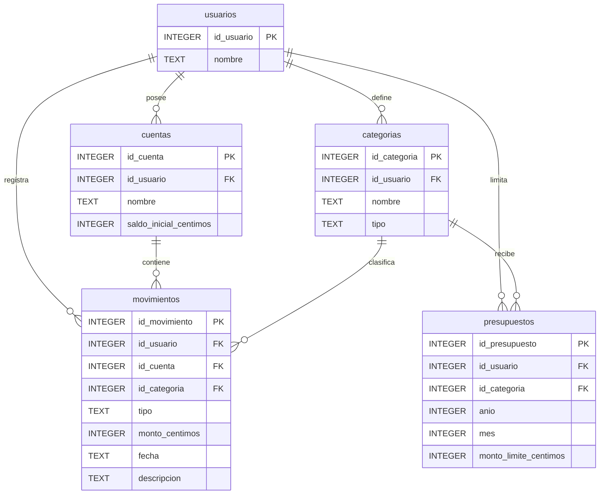

# Modelo de datos v1: subconjunto de la propuesta v4

La diapositiva 8 de la propuesta **Control de Finanzas Familiares** muestra un modelo amplio (usuarios, sesiones, categorías, cuentas, monedas, tipos de cambio, ingresos, gastos, transferencias, metas de ahorro, movimientos de ahorro, presupuestos, alertas y comprobantes). Para el seguimiento 1 se delimita un **MVP de cinco tablas**. No se pretende que el esquema simplificado sustituya el diseño objetivo completo.

| Tabla | Qué almacena | Relación |
| --- | --- | --- |
| `usuarios` | Familia de demo local (un registro). | 1:N cuentas, categorías y movimientos. |
| `categorias` | Rubro y tipo (`ingreso` / `gasto`). | 1:N movimientos; 1:N presupuestos. |
| `cuentas` | Cuenta principal o efectivo. | 1:N movimientos. |
| `movimientos` | Ingresos y gastos del MVP, unificados por tipo. | FK cuenta, categoría, usuario. |
| `presupuestos` | Límite de gasto por categoría y mes. | Unique usuario/categoría/año/mes. |

**Reconciliación con v4:** la propuesta final describe `ingresos` y `gastos` por separado; aquí se unifican en `movimientos` para evitar lógica duplicada. A cambio, queda explícitamente pospuesta cualquier transferencia, conversión monetaria o adjunto, así como las tablas respectivas del diagrama v4. El profesor puede pedir mantener el diseño v4 completo para la entrega final; conviene validar ese alcance con él.

**Índices:** `idx_movimientos_fecha_tipo`, `idx_movimientos_categoria_fecha`, `idx_presupuestos_periodo`. Se documentarán mediante `EXPLAIN QUERY PLAN` y una comparación experimental en S3.

**Integridad:** FKs habilitadas, `CHECK` sobre tipos y montos positivos, `UNIQUE` para no duplicar presupuestos y validación de categoría y cuenta en Python.

El script completo de creación está en [`src/schema.sql`](../../src/schema.sql). Los centavos se guardan como `INTEGER`; la interfaz muestra CRC en formato legible.
