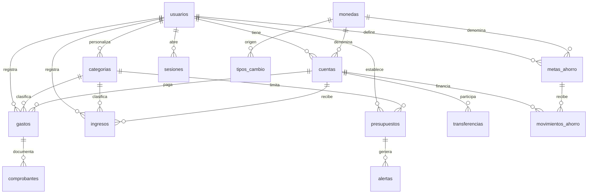

# Modelo relacional — diagrama v1

La propuesta original incluye cuentas, usuarios, monedas, ingresos, gastos, transferencias, presupuestos, alertas y ahorros. Esta vista simplificada representa las relaciones principales.

Las restricciones concretas, incluidas las dos cuentas de transferencia, se encuentran en `scripts/schema.sql`.
