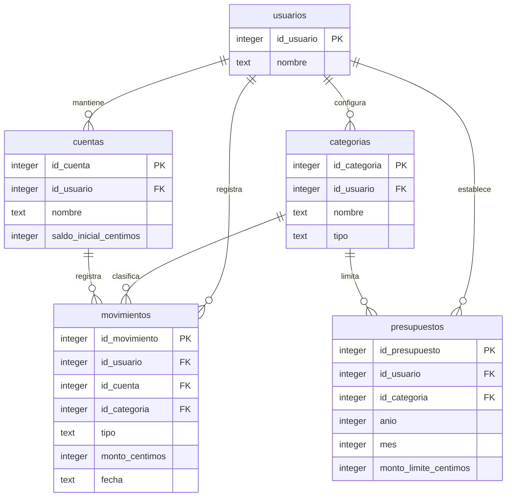

# Diagrama ER v1 — Modelo SQLite en uso

Este es el modelo real de **cinco tablas** utilizado por `src/db.py` y definido en `src/schema.sql`.

El modelo ampliado de la presentación del Grupo 5 es una **propuesta para el futuro**; no es el esquema activo. Ver `docs/modelo_datos.md`.
